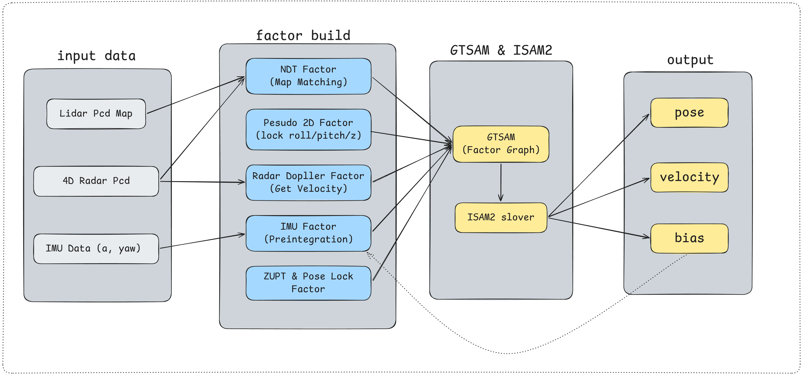

# Tightly-Coupled Radar-IMU Fusion for Autonomous Vehicle Localization
**基於因子圖之雷達與慣性感測器緊耦合定位系統**

**Speaker:** 314605004 陳昌駿 ,111612048 周士庭
**Group:** 18
**Date:** 2026/04/16

---

# 1. Introduction & Challenges

在複雜且動態的自動駕駛場景中，維持高精度與高強健性的定位是一大挑戰。

- **感測器物理限制:**
  - **IMU:** 提供高頻率動態資訊，但長時間積分會產生嚴重的累積誤差 (Drift)。
  - **4D Radar:** 具備全天候穿透能力，提供都卜勒速度 (Doppler Velocity)，但點雲稀疏且雜訊 (Noise) 高。
- **研究目標:** 設計一套 **緊耦合 (Tightly-coupled)** 系統，將多感測器資料於數學最佳化層級進行融合，消除各別感測器的缺陷，實現精準的全局軌跡定位。

---

# 2. System Architecture

採用 **因子圖最佳化 (Factor Graph Optimization)** 與 ISAM2 進行即時狀態估計：

---

# 3. Core Optimizer: GTSAM & iSAM2

### 🔹 為什麼選擇 GTSAM?
* **Global Smoothing:** 不同於 EKF 只看當下，GTSAM 考慮軌跡的「平滑性」，有效抑制累積誤差。
* **Factor Graph Model:** 將感測器觀測（IMU, Radar, NDT）具象化為約束邊，數學結構更直觀。

### 🔹 iSAM2 (Incremental Smoothing and Mapping)
1. **Incremental Update:** 僅更新受新觀測數據影響的節點，而非重算整個矩陣。
2. **Bayes Tree (貝葉斯樹):** 將複雜的機率問題轉換為樹狀結構
3. **Fluid Rerelinearization:** 自動判斷何時需要重新線性化，在精準度與速度之間取得完美平衡。

---
# 4. Factor Design Details (1/3): Foundation & Dynamics

  - **1. IMU Preintegration Factor (IMU 預積分因子)**

      - **運作機制:** 將兩個雷達幀 (約 10Hz) 之間的高頻 IMU 數據 (約 100Hz+) 透過運動學公式積分為單一相對約束。
      - **貢獻:** 提供連續且平滑的相對運動預測，同時配合 `BetweenFactor` 估計 IMU 零偏 (Bias) 的隨機漫步。

  - **2. Radar Doppler Factor (雷達都卜勒速度因子)**

      - **運作機制:** 透過 RANSAC 濾除雜訊，從雷達徑向速度估計車體 $V_x$。
      - **力臂補償亮點:** 考量雷達位於車頭的物理配置，引入剛體運動學補償 $V_y = \omega_z \times \text{LeverArm}$，精確還原轉彎時的橫向滑移速度。

---

# 4. Factor Design Details (2/3): State Constraints

利用環境先驗知識，抑制積分漂移與雜訊發散：

  - **3. ZUPT & Pose Lock Factor (零速度與位姿鎖定因子)**

      - **建立時機:** 當雷達判斷車輛處於靜止狀態。
      - **運作機制:** 強制鎖定當前速度為零 ($V = 0$)，並加入極小雜訊的相對位姿約束，徹底封鎖等紅燈或靜止時的 IMU 累積漂移。

  - **4. Pseudo-2D Constraint Factor (偽 2D 約束因子)**

      - **運作機制:** 建立虛擬水平位姿，並給予**極端不對稱的雜訊矩陣**。
      - **參數設計:** 高度 Z、翻滾角 Roll、俯仰角 Pitch 雜訊極小 ($\sigma = 10^{-3}$)；X、Y、偏航角 Yaw 雜訊極大 ($\sigma = 1000.0$)。確保 2D 平面自由移動的同時，死死鎖定高度發散。

---

# 4. Factor Design Details (3/3): Global Correction

提供絕對座標校正，消除長時間相對估計之誤差：

  - **5. NDT Map Matching Factor (NDT 地圖匹配因子)**
      - **運作機制:** 根據當前預測位置，動態裁切局部點雲地圖，並模擬「雷達近遠光燈視野」過濾無效點。
      - **信心度動態調整:** 使用 PCL 進行 NDT 配準，若收斂且 Fitness Score 良好，則將對齊結果作為**絕對位姿先驗 (PriorFactor)** 牽引當前節點。配準分數越差，則自動放大雜訊權重 (Sigma)，避免錯誤匹配拉歪整條軌跡。

-----
# 5. Experimental Results (Videos)

即時定位與建圖過程視覺化 (ROS RViz) 

  

    <h3 style="margin: 0; color: #0056b3;">🎬 Track 1: [在此輸入情境, 例如: 直線加速]</h3>
    
(上傳至 Google Slides 後，將 Track 1 影片覆蓋於此)

  

  

    <h3 style="margin: 0; color: #0056b3;">🎬 Track 2: [在此輸入情境, 例如: 彎道測試]</h3>
    
(上傳至 Google Slides 後，將 Track 2 影片覆蓋於此)

  

---

# 6. Contributions & Achievements

本研究成功實現了一套強健的自動駕駛車輛軌跡定位演算法：

1. **Robust Sensor Fusion:** 成功整合雜訊極大的 4D 雷達與易漂移的 IMU，透過 GTSAM 因子圖框架發揮兩者互補優勢。
2. **Advanced Kinematic Modeling:**
   精準的剛體力臂補償與偽 2D 約束，有效解決了轉彎時的橫向速度預測誤差與 Z 軸高度漂移問題。
3. **High-Accuracy Positioning:**
   演算法最終實現了 **Track1 ATE = 1.0, Track2 ATE = 1.4** 的定位表現。

---

# Thank You for Your Attention

### **Q & A**

