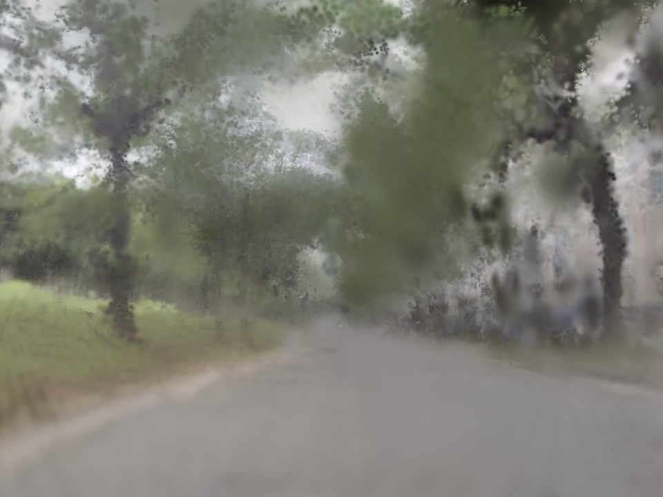
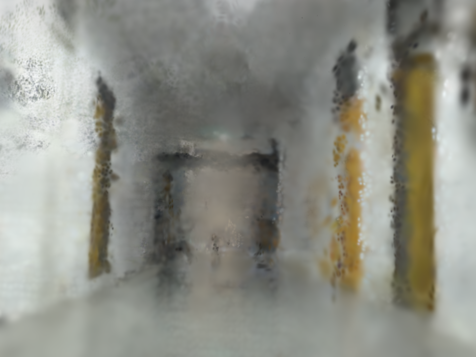
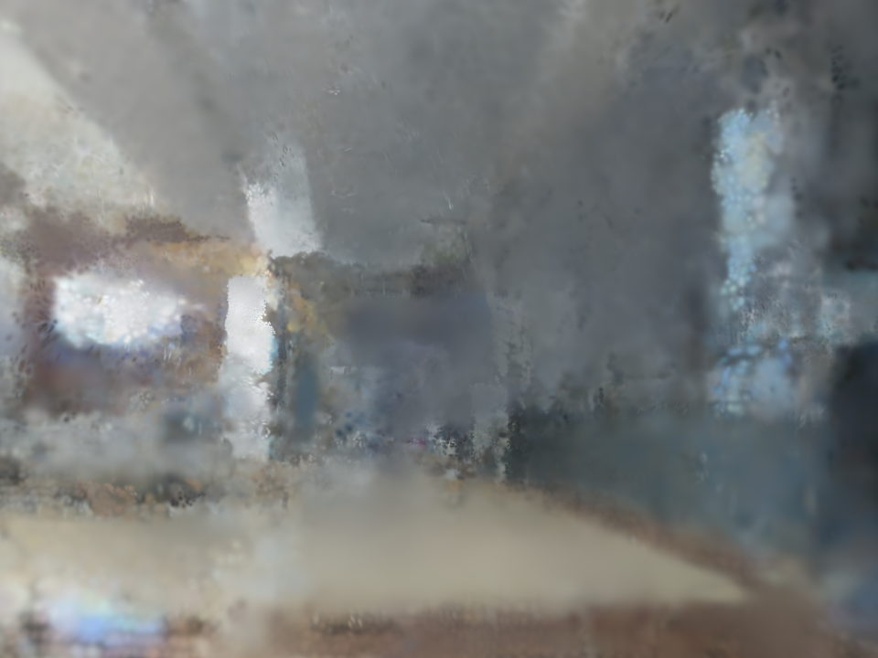
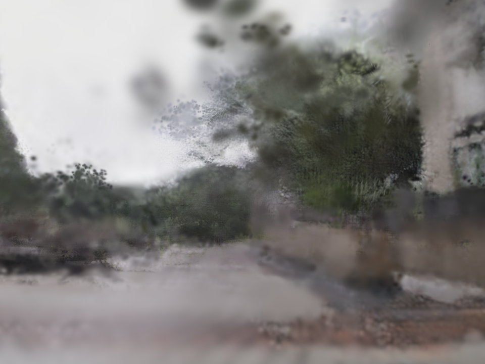

# Self Driving Car 2026

Midterm 2 presentation

Group 4: 陳昌駿、林穎沛

---

# 大綱

1. Lidar SLAM
2. 3DGS

---

# Lidar SLAM

1. ICP 兩階段點雲對齊
2. `find_candidates` 候選幀篩選
3. `match` 匹配驗證

---

# ICP

- 原理：將當前幀對齊至參考子地圖
- Coarse
    - Voxel: 0.5 m，對點雲降採樣，降低計算量
    - 對應距離門檻: 1.5 m，較寬鬆，快速找到初始對齊
    - 100 次迭代，取得粗略轉換矩陣
- Fine
    - Voxel: 0.25 m，以粗對齊結果作為初始值
    - 對應距離門檻: Voxel × 2.5，精修轉換
    - 200 次迭代，輸出最終轉換矩陣 `T`

---

# ICP

- 分數評估
    - `score = inlier 點數 / 來源總點數`
    - 若未收斂，分數強制設為 `0.0` 表示失敗

---

# `find_candidates`

- 冷卻機制
    - `min_loop_interval`
    - 檢查 `curr_idx - last_loop_idx` 是否小於冷卻設定
    - 未達間隔回傳空陣列，避免短時間內頻繁觸發

- 相鄰軌跡排除
    - `min_interval`
    - 迴圈搜尋上限設為 `curr_idx - min_interval`
    - 跳過時間上過近的歷史幀，防止將連續軌跡誤判為閉環

---

# `find_candidates`

- 距離門檻
    - `dist_thresh`
    - 提取平移向量 `poses[:3, 3]` 計算兩幀歐式距離
    - 距離大於等於門檻值者直接跳過
- 航向相似度
    - `heading_min_cos`
    - 提取旋轉矩陣 X 軸 `poses[:3, :3][:, 0]` 作為前進方向
    - 計算兩向量內積，小於相似度門檻者直接跳過

---

# `find_candidates`

- 距離優先排序
    - 將合格的候選幀與距離暫存，並依距離遞增（由近到遠）排序
- 截斷
    - `max_candidates`
    - 擷取排序後的前 `max_candidates` 個結果
    - 拋棄距離數據，僅回傳候選幀的 Index 陣列

---

# `match`

- 點雲準備
    - Source：當前幀轉換至世界座標系
    - Target：候選幀周圍的局部子地圖
- 雙向匹配
    - `T_fwd`：Forward, Source 匹配至 Target
    - `T_bwd`：Backward, Target 匹配至 Source，以 `inv(T_fwd)` 為初始值

---

# `match`

- Cycle Consistency
    - 理想狀態下 `T_fwd @ T_bwd ≈ I`
    - 計算旋轉 (`rot_err`) 與平移誤差 (`trans_err`)，超過門檻即剔除
- Correction Gate
    - 執行 `_passes_correction_gate(T_fwd)`
    - 排除不合理的劇烈跳變（如瞬間平移過大），避免錯誤匹配

---

# `match`

- Normalized Score
    - 結合 Forward 與 Backward 的正規化分數
    - 計算幾何平均數：`sqrt(score_fwd_n * score_bwd_n)`
- 閉環確認
    1. 確認最高分是否大於 `fitness_thresh`
    2. 若通過，則計算相對轉換 `T_loop = inv(poses[best_idx]) @ best_T @ curr_pose`
    3. 更新紀錄 `last_loop_idx = curr_idx`，避免後續頻繁觸發

---

[demo video](https://drive.google.com/file/d/1crqeWw4xY4o6OWauDIoZc8MmdhcWohRt/view?usp=drive_link)

---
# 3DGS

1. 球諧顏色表示
2. 損失函數拆分

---

# 球諧顏色表示

- 原版公式： $c = c_0^0 Y_0^0$
    - 設定 $l_{max}=0$，系統僅計算並優化 DC 分量 (`sh0`)
    - 渲染結果為與視角無關的固定 RGB 顏色
    - 代表物體表面被視為完美的漫反射體，無法呈現環境反光與光影變化

---

# 球諧顏色表示

- 引入觀察方向向量 $\mathbf{d}$，並啟用高階球諧函數 $l_{max} \in \{1,2,3\}$：
  $$c(\mathbf{d}) = \sum_{l=0}^{l_{max}} \sum_{m=-l}^{l} c_{l}^{m} Y_{l}^{m}(\mathbf{d})$$
    - 新增 `shN` 參數矩陣進行獨立優化，並配置學習率
    - 將顏色定義為基於視角 $\mathbf{d}$ 的動態函數
    - 透過高階係數 $c_l^m$，系統能即時計算不同觀察角度的光線補償值
    - 模擬非朗伯體反射特性，能動態重現金屬光澤與玻璃高光，提升真實度

---

# 損失函數

針對戶外場景特性，將原先單一的 L1 誤差解耦為三項獨立約束：
$$L_{total} = L_{1}(\text{obj}) + \lambda_{sky} L_{1}(\text{sky}) + \lambda_{depth} L_{1}(\text{depth})$$

- $L_{1}(\text{obj})$
    - 前景精細重建
    - 鎖定 `mask < 128` 區域
    - 嚴格計算渲染與 Ground Truth 的像素誤差，驅動物體幾何與紋理細節生成

---

# 損失函數

- $L_{1}(\text{sky})$
    - 天空冗餘抑制
    - 鎖定 `mask >= 128` 區域，賦予小權重 $\lambda_{sky}$
    - 僅提供基礎顏色引導，避免優化器為了填補天空，在無限遠處生成大量破圖與雜訊
- $L_{1}(\text{depth})$：
    - LiDAR 幾何對齊
    - 強制懲罰 2D 渲染深度與真實 LiDAR 點雲深度的誤差
    - 防止模型為了迎合圖片視角而產生扁平化的錯誤 3D 結構

---

# Masked L1 Loss

```python
def masked_l1_loss(pred: torch.Tensor, target: torch.Tensor, mask: torch.Tensor) -> torch.Tensor:
    valid_pixels = mask.sum()
    if valid_pixels.item() <= 0:
        return pred.new_tensor(0.0)
    denom = valid_pixels * pred.shape[1]
    return ((pred - target).abs() * mask).sum() / denom.clamp_min(1.0)
```

- pred: 模型預測輸出
- target: 真實目標值
- mask: 二值化張量，標示需要計算誤差的特定區域

---

# Masked L1 Loss

```python
def masked_l1_loss(pred: torch.Tensor, target: torch.Tensor, mask: torch.Tensor) -> torch.Tensor:
    valid_pixels = mask.sum()
    if valid_pixels.item() <= 0:
        return pred.new_tensor(0.0)
    denom = valid_pixels * pred.shape[1]
    return ((pred - target).abs() * mask).sum() / denom.clamp_min(1.0)
```

- `valid_pixels`：遮罩內被標記為 1 的有效像素總數
- `pred.shape[1]`：影像的通道數（RGB 影像的通道數為 3）
- `denom`：個遮罩區域內，實際參與誤差評估的總數值節點數量，確保不受遮罩面積大小影響
- `(pred - target).abs() * mask).sum()`：計算預測與目標之間的絕對誤差，並僅對遮罩內的像素進行求和

---



---



---



---


